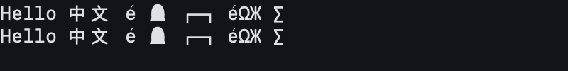
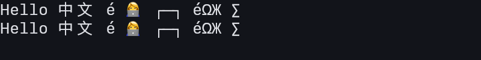

# Apple shared-renderer implementation and observations

Date: 2026-10-17. Architecture: [one renderer, native hosts](renderer-architecture.md).
The implementation uses the shared Rust renderer on macOS and iOS, with Metal
presentation through wgpu. The independent Swift Metal and Canvas painters are
removed. This report records development evidence; combined Apple release
qualification remains incomplete.

## Reproduce the short comparison

Build `scripts/build-xcframework.sh`, then run:

```sh
python3 scripts/evaluate-apple-renderer.py \
  --baseline 0af920417b704743aad89d7803d2861355da8223 \
  --output artifacts/render-unification/apple-observations
```

The output directory must be new. The script extracts the historical Metal
renderer into that ignored directory and builds a release measurement harness.
No legacy renderer remains in production sources. The summary records source,
native library and harness hashes because the working tree is uncommitted and
the HEAD revision alone does not identify the measured implementation.

Measurements use an Apple M4, macOS 27.0.1, a 26 physical-pixel font and offscreen
targets. Each case changes text on every frame, performs 3 warmup draws and
collects 20 samples. Both implementations wait for GPU completion outside the
CPU submission span. Screenshot export is separate. These are short local
observations, not displayed latency, FPS, isolated GPU pass times or CI limits.

## Correctness and build evidence

- Rust workspace checks, layout/damage tests and architecture guards pass.
  The guards also test rejection of native terminal painters and glyph atlases.
- macOS frontend tests pass: 47 UI tests and 9 plugin tests. Shared GPU pixel
  tests cover first-frame empty damage, unchanged text, changed rows, hidden
  text, palette/geometry invalidation, last-column clipping, cursor removal,
  decorations, selection/link overlays, font fallback and CJK atlas turnover.
- iOS simulator frontend tests cover the same shared pixel and font contracts.
  Native layer tests cover attachment, cancellation and recreation. The package
  test runner has no application window scene; its layer tests do not establish
  keyboard, rotation or foreground/background scene behavior.
- Font tests cover invalid bytes preserving the catalogue, import de-duplication,
  stored-file reload and shared measurements at scales 1, 2 and 3. Apple virtual
  system fonts are supplied as CoreText tables and shaped by the shared stack.
- The three XCFramework targets build with `render`. Swift and C# generated
  bindings match their generators. The C# facade compiles with warnings as errors.
  The unsigned iOS application builds for arm64. SDK and application Swift tests
  also pass.

The Windows application requires the Windows XAML/native build tools; its full
native build and DX12 runtime have not been verified on this Mac. The facade
compile does not establish Windows application qualification.

## Observations and limits

The retained [summary](renderer-evaluation/apple-summary.json), resource logs and
font images accompany this report. CPU submission and completion percentiles
are reported independently; they must not be added together. A single short run
does not establish sustained performance, startup latency or battery cost.

Values below are milliseconds, shown as historical Metal / shared wgpu:

| Workload | CPU submission p95 | Update through GPU completion p95 |
| --- | ---: | ---: |
| 80×24 prose | 0.82 / 0.18 | 1.40 / 0.69 |
| 120×40 highlighted | 3.19 / 0.35 | 3.96 / 1.06 |
| 200×60 highlighted | 6.39 / 0.64 | 7.32 / 1.91 |
| 120×40 per-cell styles | 42.52 / 2.70 | 43.59 / 3.45 |

Whole-process maximum RSS was 90.3 / 63.6 MiB; macOS reported peak memory
footprint of 151.6 / 145.8 MiB. These include initialization, the four sequential
surfaces and the small final screenshot. They are different OS accounting
metrics, not renderer-only allocations or a multi-terminal endurance test.
Raw logs: [historical Metal](renderer-evaluation/apple-metal-resources.txt),
[shared wgpu](renderer-evaluation/apple-wgpu-resources.txt).

An earlier diagnostic run read back every full-sized frame and reached roughly
1 GiB peak RSS. Separating bulk screenshot readback from ordinary rendering
removed that growth in this harness. Reusing the readback buffer alone did not
remove it. The retained normal-drawing results do not resolve sustained bulk
capture behavior; readback is a diagnostic API, outside native terminal drawing.

The font samples contain English, CJK, a combining accent and an emoji ZWJ
sequence. The shared path renders colored emoji; the historical atlas was
monochrome. Different rasterization and fallback can change appearance, so these
images are comparison evidence rather than pixel-equality baselines.





## Outstanding combined-release qualification

Before releasing macOS and iOS together, verify on actual iPhone/iPad and macOS
app windows: rotation, keyboard/IME movement, display-scale changes, foreground
recovery, multiple terminals, rapid close/reopen, font quality and imported fonts
after a full application restart. Record sustained CPU/GPU, startup, memory and
power observations. GPU pass timing, displayed FPS and power are currently
unknown. Physical iOS runtime qualification has not been performed.

Unresolved regressions delay the combined Apple release. Release recovery uses
version rollback, as specified in [ADR 0021](../Decisions/0021-renderer-unification-is-measurement-gated.md).
